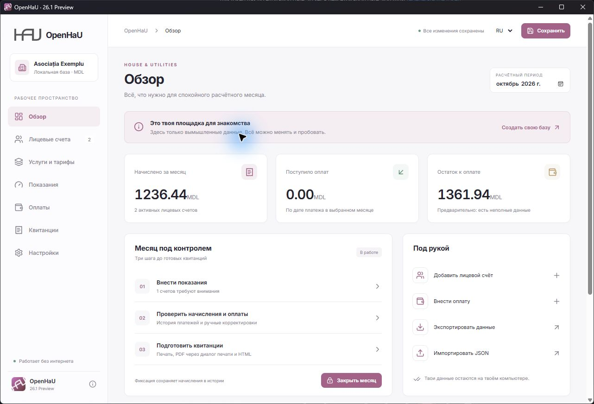

<p align="center"></p>

<h1 align="center">OpenHaU</h1>
<p align="center">House & Utilities · Учёт с заботой о людях</p>
<p align="center">Офлайн · Русский / Română · SQLite · Windows + macOS</p>

OpenHaU — настольное приложение для небольшой ассоциации жильцов.
Проект начался с желания сделать удобную программу для бабушки:
с редактируемыми реквизитами, понятными начислениями и красивыми квитанциями.

**26.1 Preview — предварительная версия для проверки на вымышленных данных.**
Она не заменяет проверенную бухгалтерскую систему. Правила начисления
и округления нужно подтвердить с бухгалтером, затем сверять результаты
параллельно с действующей системой.



## Возможности

- Лицевые счета, несколько квартир на один счёт, площадь, жители и отдельное
  число людей для начисления за мусор.
- Редактируемые услуги: счётчик, человек, площадь, фиксированный и ручной объём.
- Тарифы с историей, действующие с первого дня месяца.
- Показания, ручная замена объёма, оплаты и корректировки.
- Точная десятичная арифметика; выбор half up / half even.
- Закрытие месяца с сохранением начислений; повторное открытие для исправлений.
- Системная, светлая и тёмная темы; собственный акцентный цвет.
- Квитанции на русском, румынском или двух языках: Studio, Compact и Classic.
- Цвет квитанции, SVG / PNG / JPEG / WebP логотип организации и конфигурации оформления.
- SQLite с резервной копией перед сохранением существующей базы.
- Полный JSON с проверяемым импортом, CSV-сводка и HTML-квитанции для печати.

## Скачать и установить

Проверенные сборки публикуются в [Releases](https://github.com/OldschoolNetwork/open-hau/releases).
Наличие исходников или workflow не означает, что сборка уже опубликована.

- **Windows x64:** установщик NSIS либо самостоятельный EXE. Нужен WebView2;
  установщик может предложить загрузить его, если компонента нет.
- **macOS:** предусмотрен универсальный DMG для Intel и Apple Silicon:
  перетащи OpenHaU в Applications. SQLite включён в приложение; Rust и Node.js
  пользователю не нужны. Цель совместимости — Monterey 12.6 и новее.
  Подпись Apple и notarization требуют отдельной настройки. До проверки
  на настоящем Monterey Mac-версия считается неподтверждённой.

Облачная сборка — [build.yml](.github/workflows/build.yml).
Ручной запуск в GitHub Actions собирает Windows и универсальный macOS DMG.
[Список проверок на Monterey](docs/monterey-feedback.md) подготовлен для отзыва.

## Разработка

Нужны Node.js 24 LTS, Rust и системные инструменты сборки Tauri.
На Windows — MSVC C++ и Windows SDK, на Mac — инструменты Xcode.

```sh
npm ci
npm test
npm run check
npm run tauri dev
```

```sh
# Windows
npm run tauri build
# macOS (выполняется на Mac)
rustup target add aarch64-apple-darwin x86_64-apple-darwin
npm run tauri build -- --target universal-apple-darwin --config src-tauri/tauri.macos.conf.json
```

В локальной папке родительский `dev-env.ps1` подключает инструменты,
установленные на D:, только для текущей сессии PowerShell.

`npm run dev` открывает браузерный предпросмотр: он использует localStorage,
а не нативную SQLite-базу. Рабочая база настольной версии находится
в каталоге данных приложения, путь показан в настройках.

## Формат и сохранение

Данные сохраняются кнопкой **Сохранить** или Ctrl/Cmd+S. Введённые показания
сначала нужно применить. При выходе с несохранёнными изменениями приложение
предложит сохранение.

Рабочий файл — `openhau.sqlite`. Таблица `project_sections` хранит разделы
проекта в виде JSON; `save_log` — журнал сохранений. Перед перезаписью
существующей базы SQLite Backup API создаёт согласованную копию в `backups`.
Копии пока не удаляются автоматически.

[Описание открытого формата](docs/data-format.md) ·
[Пример JSON](examples/demo.openhau.json) ·
[План обновлений](docs/updates.md) · [Проверка версии](docs/testing.md)

Редактируй экспортированный JSON и импортируй его с предварительной
проверкой. Не редактируй SQLite, пока приложение работает. CSV — сводка,
не полная резервная копия. Логотипы и конфигурации включены в JSON.

## Ограничения Preview

Нет автоматического распределения общедомовых расходов, импорта Инфокрафта,
серединных изменений тарифов, льгот, пеней и регламентированной отчётности.
Общие расходы пока вводятся ручным объёмом. Пользовательские HTML-шаблоны
и автоматические обновления запланированы отдельно.

PDF сохраняется через системный диалог печати. Если встроенная печать
недоступна, экспортируй HTML и распечатай его из браузера. Неполные данные
помечаются как черновик; закрыть такой месяц нельзя.

## Конфиденциальность

Приложение не отправляет бухгалтерские данные на сервер. В репозитории
только вымышленные примеры, исходный код и авторская графика. Рабочие базы,
квитанции жильцов, сторонние установщики и ключи не публикуются.

## Oldschool Network

[Website](https://oldschoolnetwork.online/) ·
[Bluesky](https://bsky.app/profile/oldnet.bsky.social) ·
[YouTube](https://www.youtube.com/@oldschoolnetwork) ·
[X](https://x.com/oldschool_net) ·
[Telegram](https://t.me/OldschoolNetwork)
