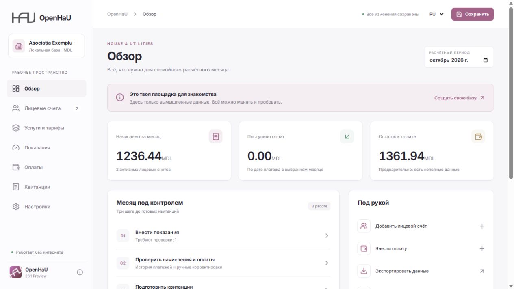

<p align="center"></p>

<h1 align="center">OpenHaU</h1>
<p align="center">House & Utilities</p>
<p align="center">Offline accounting · Russian / Romanian · Windows + macOS</p>

OpenHaU is a desktop workspace for small housing associations. Manage accounts,
tariffs, readings and payments, then prepare receipts with your organisation's
identity. No mandatory account or cloud connection is required.

**26.1 Preview is a preliminary release.** Start with fictional data and verify
calculations alongside an established system before relying on them.

This branch contains **26.2 development work**. The published 26.1 preview remains
the current downloadable release. Development data uses format 2 and reads format 1;
keep an independent backup before trying it. See the
[development capability matrix](docs/capabilities-26.2.md) for implementation status.



## Features

- Personal accounts with multiple apartments, area, residents and a separate
  person count for waste charges.
- Metered, per-person, area-based, fixed and manually entered quantities.
- Dated tariffs, payments, adjustments and decimal arithmetic.
- Closed-period snapshots that preserve historical charges.
- System, light and dark themes; Russian and Romanian interfaces.
- Studio, Compact and Classic receipts in Russian, Romanian or both.
- Receipt colours, type sizes, SVG/PNG/JPEG/WebP logos and saved configurations.
- Local SQLite storage with a backup before saving an existing database.
- Validated full JSON exchange, monthly CSV summaries and printable HTML.

## Download

[26.1 First Preview](https://github.com/OldschoolNetwork/open-hau/releases/tag/v26.1.0-preview.1)
includes SHA-256 checksums and these files:

- **macOS:** universal Intel/Apple Silicon DMG, 6.4 MiB. Drag OpenHaU to
  Applications. Target: macOS Monterey 12.6 or later. No Rust, Node.js or separate
  SQLite installation is needed.
- **Windows x64:** installer, 2.2 MiB, or standalone EXE, 7.4 MiB.
  Microsoft Edge WebView2 Runtime is required; the installer can download it
  when missing. The standalone EXE is not a portable-data mode.

The Mac preview is not signed with Apple Developer ID or notarized.
Launch and a superficial functional check were reported successful on Monterey
after removing a download quarantine flag. This is not a complete acceptance test.
See [first-launch troubleshooting](docs/guide/troubleshooting.md) and the
[Mac test checklist](docs/monterey-feedback.md).

## Documentation

[User guide](docs/guide/index.md) · [Benefits and recalculation](docs/administration.md) · [Data format](docs/data-format.md) ·
[Example project](examples/demo.openhau.json) · [Testing](docs/testing.md) ·
[Updates](docs/updates.md) · [26.2 roadmap](docs/roadmap-26.2.md)

The user guide and public documentation are in English. The application currently
provides Russian and Romanian interfaces; screenshots show the localized UI.
[Project wiki sources](wiki/Home.md) contain the same guide in GitHub Wiki format.

## Storage and privacy

Save explicitly with the save control or Ctrl/Cmd+S. Apply edited readings before
saving. Unsaved changes trigger a prompt when closing the desktop window.

The desktop database is `openhau.sqlite`; its location is shown in settings.
The `project_sections` table stores JSON sections and `save_log` records saves.
SQLite Backup API creates a consistent copy before overwriting a nonempty database.
Backups are not automatically pruned.

Full `*.openhau.json` export includes records, settings, logos and receipt
configurations. Import replaces the project rather than merging it.
CSV is a monthly summary, not a full backup. Never edit the live SQLite database.
The application does not upload accounting records to a server. Files are not
encrypted by the application; protect the device and independent backups.

## Preview limitations

There is no automatic common-area allocation, general-purpose legacy importer,
mid-month tariff splitting, regulated reporting, turnover/balance report suite,
template editor or automatic updater. Common quantities can be entered manually.
An incomplete calculation is marked as a draft and cannot close the month.

PDF output uses the system print dialog. If it is unavailable, export HTML and
print from a browser. Verify pagination, Romanian characters and monochrome output
before printing a full batch.

## Development

Requires Node.js 24, Rust and Tauri's platform build tools: MSVC C++/Windows SDK
on Windows, or Xcode tools on macOS.

```sh
npm ci
npm test
npm run check
npm run tauri dev
```

```sh
# Windows
npm run tauri build
# macOS, executed on a Mac
rustup target add aarch64-apple-darwin x86_64-apple-darwin
npm run tauri build -- --target universal-apple-darwin --config src-tauri/tauri.macos.conf.json
```

`npm run dev` is a browser preview using localStorage, not desktop SQLite.
Calculations use decimal.js in TypeScript; Rust handles native storage and files.
[GitHub Actions](.github/workflows/build.yml) can build Windows and universal DMG
artifacts through manual dispatch.

## Website

`website/openhau/` contains the landing page and web wiki prepared for the
Oldschool Network website. The source being present does not establish deployment.
See [website maintenance](website/README.md). Only fictional demonstrations and
project-owned branding belong in public screenshots and examples.

## Oldschool Network

[Website](https://oldschoolnetwork.online/) ·
[Bluesky](https://bsky.app/profile/oldnet.bsky.social) ·
[YouTube](https://www.youtube.com/@oldschoolnetwork) ·
[X](https://x.com/oldschool_net) ·
[Telegram](https://t.me/OldschoolNetwork)

For the 26.2 account workspace, see [Personal accounts](docs/personal-accounts.md).

The source checkout includes a [local database API](docs/database-api.md) for
validated file operations and history merges over command line or JSON-RPC stdio.
