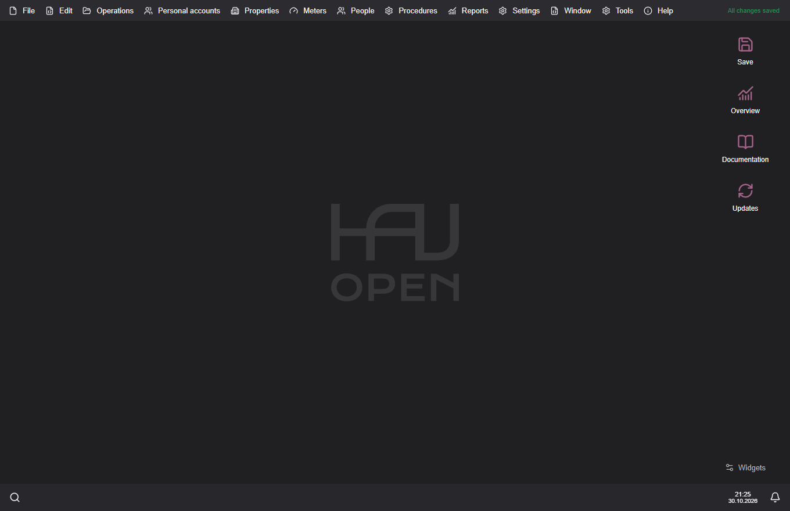

# OpenHaU user guide

OpenHaU is an offline utility accounting application for housing associations.
The interface supports English, Romanian and Russian. Accounting uses MDL.

## Contents

- [Installation and updates](installation.md)
- [Organisation and personal accounts](setup.md)
- [Monthly workflow and reports](monthly-work.md)
- [Receipts and PDF](receipts.md)
- [Database files, protection and backups](data-and-backups.md)
- [Local API](api.md)
- [Troubleshooting](troubleshooting.md)

## First steps

1. Create a database or add an existing ODB file from the welcome screen.
2. Check organisation details, accounts, connected services, tariffs and meters.
3. Select the billing period and enter readings, occupancy changes and payments.
4. Review the reports and prepare receipts for the selected month.
5. Save the database and keep an independent backup.

## Windows and macOS

The application keeps the same accounting data on both platforms. Choose the
package for your operating system and keep a backup before moving a working
database between application versions. A newer application can migrate an older
database; an older application may refuse a newer schema.

[Project repository](https://github.com/OldschoolNetwork/open-hau)
