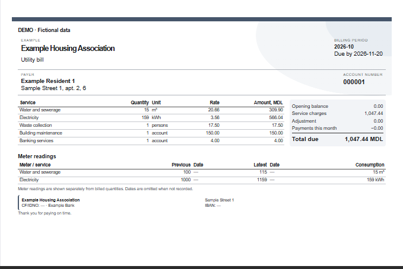

# Receipts and PDF

Select the receipt month and year, then choose the accounts to include. Previous
months remain available; verify that the selected period has complete data.

## Appearance

Choose a built-in design, accent colour, type size, paper layout and orientation.
SVG, PNG, JPEG and WebP organisation logos are supported. Appearance configurations
and imported logos can be saved in the database.

The receipt editor controls the background, shapes and document elements.
Use the preview and a sample PDF to check a custom layout before a print run.

## Receipt contents

Open Receipt contents to choose optional blocks, meter types and services.
For example, include only water and electricity meters rather than every
accounting counter. Individual meters can also be excluded.

Previous reading, latest reading, dates, consumption, serial number and the
displayed meter/service label can be configured. When no readings are selected,
their table is omitted. Required account identity, charges and totals remain.

## Payment deadline

Set the deadline for the selected month. Date and period formatting follows
the configured formats and receipt language.

## Output

Save PDF produces a PDF file. Print opens the print workflow. HTML is an
additional export. Choose one or two receipts per A4 sheet, orientation and
cutting guides before output. Check the selected printer’s colour settings.

A draft notice means the calculation has missing readings, tariffs or history.
Resolve the missing information before treating the amount as final.

[Monthly workflow](monthly-work.md)
