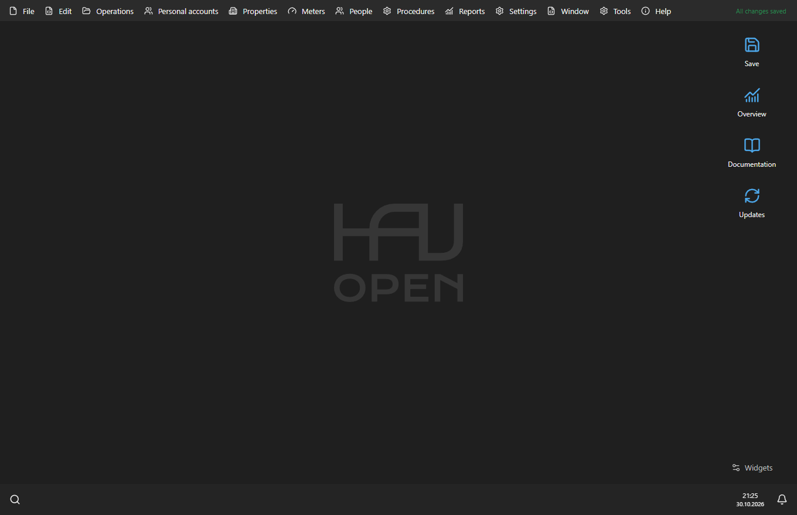

# Organisation and personal accounts

## Mac preferences and navigation

On macOS, OpenHaU → Preferences opens a grid of preference categories. Use
Show All to return to the grid, or search for a setting in the upper-right field.
Category illustrations are separate from the monochrome command symbols.

The system menu bar provides the application commands. The optional toolbar
inside the workspace can collapse to the left and expand to the right using
its arrow. Workspace → Add Workspace Shortcut adds a shortcut without dragging
from the system menu; the internal toolbar also supports dragging commands.

Keyboard shortcuts use Mac symbols: Command ⌘, Option ⌥, Shift ⇧ and Control ⌃.

## Organisation

Enter the current organisation name, association code, CF/IDNO, address, bank
and IBAN in Settings → Organisation. Verify them in the receipt preview.
The code is not repeated above the organisation name when both values match.

## Accounts

Use Personal accounts to view, find and edit accounts. Account documents record
opening, closing, changes to residents and changes to connected services.
Keep the original account number when migrating historical records.

The account card includes its holder, property, residents, services, meters,
additional objects and characteristics. Use dated documents for historical changes.
Set the waste-charge person count for each month rather than replacing past months.

## Services and tariffs

Each service has a calculation basis, unit, supplier, connected meter types and
tariff history. Give each tariff an effective date. A transition-month price can
be entered manually; the following month uses the next applicable tariff.

## Table navigation

Click a column heading to sort ascending, then descending. A third click restores
the original order. Shift-click adds a secondary sort column. Reset sorting
clears the active sorting. Search and filters narrow the displayed records.

[Monthly workflow](monthly-work.md)
